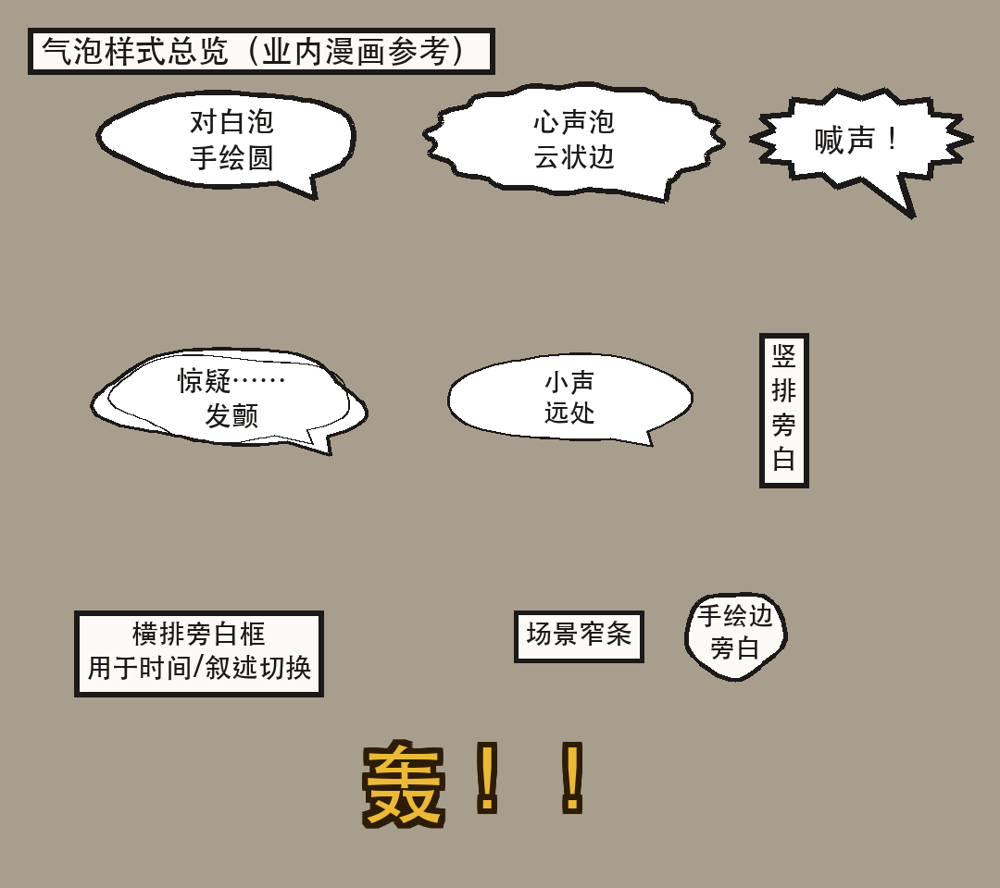

# Novel-to-Comic · 小说原文到完整漫画剧集的生产流水线

> **把任意网络小说/长篇故事改写成连载漫画剧集**的端到端方法论 + 工具集。
> 输入一段原文，输出可发布的完整漫画页（9:16 竖版，1080×1920）。

---

## 这是什么

把一部小说变成一部连载漫画，需要解决的工程问题比想象中多：

- 几百个角色怎么定妆才能不撞脸？
- 几百个场景怎么定妆才能保持视觉一致性？
- 一段 2000 字的章节要怎么切成可读的分镜？
- 生图模型的脸每次都漂移怎么办？
- 气泡怎么画才能像业内漫画？
- 交付前哪些机械问题必须修，哪些可以放过？

**Novel-to-Comic** 是从 5+ 个月的连载实战中提炼出来的方法论与工具集：

- **4 份子 skill**：角色定妆 / 场景定妆 / 单集出图 / QA 门禁（+ 主入口 `SKILL.md`）
- **4 个可复用工具**：气泡绘制库、7 项自动质检、引用断链体检、角色卡拼装参考实现
- **6 份模板**：角色卡 / 场景卡 / 节拍表 / 叠泡脚本 / 提示词骨架 / 发布文案
- **7 份文档**：项目概览 / 端到端流水线 / 三大体系 / 发布交付 / 经验教训

---

## 看效果 · 工具直接出的气泡样张

`tools/bubble_lib.py` 一次跑出来，无需任何外部依赖：



包含 5 类气泡（对白/心声/喊声/发颤/远声）+ 3 类旁白（横排/竖排/场景窄条）+ 1 类手绘边旁白 + 浮字拟声词。

跑一下自己也能生成：

```bash
python3 tools/bubble_lib.py
# → tools/_bubble_samples/ 9 张分样式
# → tools/_bubble_samples_overview.png 总览
```

---

## 适用对象

| 你是 | 这套东西能帮你 |
|------|---------------|
| 小说作者想把作品漫改 | 拿到一份"开即别跑偏"的工业化流程 |
| AI 产品/研究想做长内容生产 | 拿到一组"怎么在生图模型上做系列视觉一致性"的工程答案 |
| 设计师/画师接到漫改外包 | 拿到一个别人验证过的提示词骨架 + 锁脸方案 |
| 个人想把自己的网文转成漫画 | 拿到一条"开箱即用"的流水线，按部就班照做 |

---

## 项目结构

```
novel-to-comic/
├── SKILL.md                 # 主入口 skill（先读这一份）
├── README.md                # 你正在读的
├── requirements.txt         # Python 依赖
├── tools/                   # 可复用脚本
│   ├── bubble_lib.py        # 气泡绘制公共库（方案A：画面/文字分离）
│   ├── qa_check.py          # 7 项自动质检门禁
│   ├── check_refs.py        # 文档/脚本引用断链体检
│   ├── compose_card.py      # 角色卡拼装脚本（参考实现）
│   ├── _bubble_samples/     # 9 张气泡样式样张（运行后生成）
│   └── _bubble_samples_overview.png   # 气泡总览（运行后生成）
├── docs/                    # 设计文档与方法论详解
│   ├── 01-overview.md
│   ├── 02-pipeline.md
│   ├── 03-character-card.md
│   ├── 04-scene-card.md
│   ├── 05-episode-page.md
│   ├── 06-publishing.md
│   └── 07-lessons-learned.md
├── templates/               # 各种可直接复用的模板
│   ├── character-card.md
│   ├── scene-card.md
│   ├── episode-pacing.md
│   ├── episode-script.md
│   ├── prompt-skeleton.md
│   └── publish-doc.md
├── skills/                  # 4 份子 skill，每份管一个阶段
│   ├── novel-character-card/   # 角色定妆流水线
│   ├── novel-scene-card/       # 场景定妆流水线
│   ├── novel-episode-page/     # 单集出图流水线
│   └── novel-qa-gate/          # QA 门禁流水线
└── examples/                # 使用示例（用任意小说试跑）
    └── README.md
```

---

## 5 分钟极速上手

### 1. 安装

```bash
git clone https://github.com/oliver0518/novel-to-comic.git
cd novel-to-comic
pip install -r requirements.txt
```

### 2. 看一眼工具能做什么

```bash
python3 tools/bubble_lib.py          # 9 张气泡样张
python3 tools/qa_check.py --help     # 7 项检查
python3 tools/check_refs.py          # 0 缺失（自检）
```

### 3. 让 AI 助手接管

把 `SKILL.md` 加载到你使用的 AI 助手（Claude / Cursor / MCode 等）里。说一句：

> "我要把《XXX》小说改成漫画。先帮我做角色定妆。"

AI 会自动加载 `skills/novel-character-card/`、读取 `templates/character-card.md`、按它的流程做事。

### 4. 跑门禁

每集出图完成后：

```bash
python3 tools/qa_check.py <你的成品目录>
python3 tools/check_refs.py
```

零 ERROR 即可交付。

---

## 核心原则（铁律 7 条）

1. **画面/文字分离（方案A）**——生图模型画的文字/气泡全不稳定，**所有中文必须 PIL 后期叠**。
2. **9:16 直出**——`1080×1920` 一次到位，**不再走 2:3 留白→裁剪**。
3. **锁脸 = 双图挂载**——`image1` 往期成品页（画风基准）、`image2` 角色定妆照（脸基准），`input_fidelity:"high"`。
4. **定妆先行**——**先验类缺陷全部堵在出图前**（撞脸、道具带字、环境白背景、断肢、额头带子），不做后期救火。
5. **白条分隔条**——业内漫画分隔条就是白条，**禁黑条**。
6. **集级设定卡**——出图前 5 分钟写一张卡（出场角色定妆号、反派族属、道具清单、颜色纪律），省后期返工。
7. **零 ERROR 才交付**——QA 门禁 7 项机械检查全过才算交付完。

每条都有实证教训，详见 [`docs/07-lessons-learned.md`](docs/07-lessons-learned.md)。

---

## 端到端流程速览

```
阶段 0   项目初始化（建仓、抓文稿、设定大纲）
阶段 1   角色定妆（写实卡 + Q 版卡，详情见 skills/novel-character-card/）
阶段 2   场景定妆（场景卡 + 道具图鉴，详情见 skills/novel-scene-card/）
阶段 3   漫改大纲（N 集总表 + 节拍表）
阶段 4   集级设定卡（出图前 5 分钟，5 大类先验缺陷堵在出图前）
阶段 5   单集出图（生图 → 后期 → 封面顶栏，详情见 skills/novel-episode-page/）
阶段 6   QA 门禁（qa_check.py + check_refs.py，详情见 skills/novel-qa-gate/）
阶段 7   发布交付（一条 5-6 张 + 发布文案.md，详情见 docs/06-publishing.md）
```

完整版见 [`docs/02-pipeline.md`](docs/02-pipeline.md)。

---

## 子 skill 索引

| Skill | 内容 | 何时加载 |
|-------|------|----------|
| [`skills/novel-character-card/`](skills/novel-character-card/) | 角色定妆流水线：考据 → 10 张分件 → 双卡组装 → 引用表同步 → 旧文件清理 | 做/升级/补任意角色卡时 |
| [`skills/novel-scene-card/`](skills/novel-scene-card/) | 场景定妆流水线：场景分级 → 场景卡 → 道具图鉴 → 引用同步 | 重要场景首次出场时 |
| [`skills/novel-episode-page/`](skills/novel-episode-page/) | 单集出图流水线：节拍表 → 集级设定卡 → 生图 → 后期 → 封面 | 出任意一集时 |
| [`skills/novel-qa-gate/`](skills/novel-qa-gate/) | QA 门禁流水线：7 项自动检查 + 引用体检 + 返修决策表 | 任何交付前 |

---

## 验证状态

| 检查项 | 状态 |
|-------|------|
| `python3 tools/check_refs.py` | ✅ 0 缺失 |
| `python3 tools/bubble_lib.py` | ✅ 9 张气泡样张生成成功 |
| `python3 tools/qa_check.py --help` | ✅ 命令行参数正确 |
| `python3 tools/check_refs.py --help` | ✅ 命令行参数正确 |

---

## 贡献

欢迎补完文档、提交新模板、贡献新子 skill。

所有贡献请附带"这条经验是从哪个真实踩坑里来的"一行说明——没有教训背书的规则不可信。

---

## 许可证

本仓库方法论与工具以 MIT 协议开源。